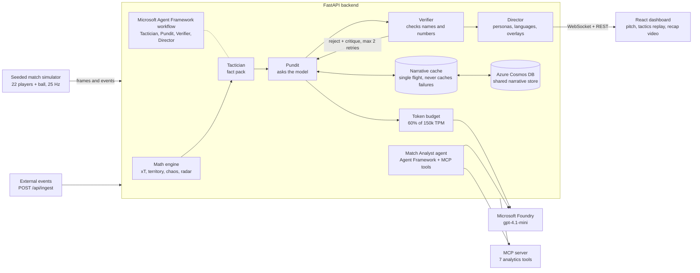

# InGame Studio: AI football match intelligence on Microsoft Foundry and Azure

**An AI insights engine for live football. It reads match tracking data as it happens, explains why each moment matters, and tells that story differently for every viewer, in English and Spanish. Built on Microsoft Foundry, Microsoft Agent Framework, Azure Cosmos DB and Azure Container Apps for the Microsoft "Inside the Game" hackathon.**

[][live]
[](https://github.com/amanpundhir/ingame-studio/actions/workflows/deploy-azure.yml)
[](LICENSE)
[](#why-this-fits-best-use-of-microsoft-foundry)
[](#deploy-to-azure-container-apps)
[](#run-it)
[](#run-it)

**[Live demo][live]** · **[Demo video][video]** · **[Hackathon fit](#hackathon-requirements-and-where-they-are-implemented)** · **[Architecture](#architecture-the-multi-agent-pipeline)** · **[Run it](#run-it)** · **[API](#api-routes)**

> **Data notice:** every club, player, match and number in this project is synthetic. The two clubs (Northbridge Lions and Harbourside City) and all players are fictional. Nothing here is an official feed or refers to a real person or organisation.

[live]: https://app-ingame-kkubzmbwg2t4c.greensand-a835732b.eastus.azurecontainerapps.io/
[video]: https://app-ingame-kkubzmbwg2t4c.greensand-a835732b.eastus.azurecontainerapps.io/

## Contents

- [At a glance](#at-a-glance)
- [Try the live demo](#try-the-live-demo)
- [Pitch](#pitch)
- [Hackathon requirements and where they are implemented](#hackathon-requirements-and-where-they-are-implemented)
- [Judging criteria](#judging-criteria)
- [Why this fits Best Use of Microsoft Foundry](#why-this-fits-best-use-of-microsoft-foundry)
- [Architecture: the multi-agent pipeline](#architecture-the-multi-agent-pipeline)
- [Features: live match intelligence, personas and recaps](#features-live-match-intelligence-personas-and-recaps)
- [Cost control: cache, single flight and token budget](#cost-control-cache-single-flight-and-token-budget)
- [Overlay message format for broadcast graphics](#overlay-message-format-for-broadcast-graphics)
- [For developers](#for-developers)
- [Security and known limits](#security-and-known-limits)
- [Licence and conduct](#licence-and-conduct)

## At a glance

| | |
|---|---|
| **Tracking data** | 22 players and the ball at 25 Hz, for a full 94:30 synthetic match |
| **Events** | 1,574 in the default match: passes, shots, goals, tackles, turnovers, pressure, fouls, cards, substitutions |
| **AI agents** | 5 Microsoft Agent Framework agents: Tactician, Pundit, Verifier and Director in one workflow, plus the Match Analyst |
| **MCP tools** | 7 match-analytics tools on our own Model Context Protocol server |
| **Personas and languages** | 4 personas (Casual, Tactical, Club, Fantasy) in 2 languages (English, Spanish) |
| **Cache** | about 97% of narrative requests on the live demo answered from the verified cache (27 October 2026) |
| **Tests** | 415 automated tests, run by GitHub Actions before every deployment |

## Try the live demo

1. Open the [live demo][live] (no sign-in needed).
2. Your match starts from kick-off as soon as the page opens, and it is **yours alone**: every browser tab gets its own match, so Play, Pause, Reset and the speed buttons (2x, 5x, 10x, 20x) never affect anyone else. Reloading the page continues your match. It lasts 94:30; pressing Play after full time restarts it.
3. Pick a persona in the top bar (Casual, Tactical, Club, Fantasy) and a language (EN or ES): every tab follows it.
4. Open the **Tactics** tab for replays of the key moments, **Players** for heatmaps, passing lanes and radar, **Recap** for the highlights video, and use the chat bubble (bottom right of the InGame tab) to ask the Match Analyst about the match as it stands.
5. `/api/llm/status` on the same address shows the live status: Microsoft Foundry connected, the Azure Cosmos DB store and the Microsoft Agent Framework workflow.

The app is deployed from this repository by GitHub Actions to Azure Container Apps.

## Pitch

**What I built.** A complete match-intelligence studio. A seeded simulator plays a 94-minute match (22 players and a ball at 25 Hz, with passes, shots, goals, tackles, pressure, turnovers, fouls, cards and substitutions, and the teams changing ends at half-time). Every event is turned into structured facts, explained by a language model, checked against the tracking data, and rendered as ticker lines, telestrator vectors, alerts, player cards, replay clips, a highlights video and a match story.

**Which Microsoft and Azure technologies it uses.**

| Technology | How it is used |
|---|---|
| **Microsoft Foundry** (formerly Azure AI Foundry), `gpt-4.1-mini` deployment | Writes every event narrative, the match stories and the tactical analyses, in English and Spanish. Calls go through one adapter with retry and back-off, a rolling token budget that stays under the 150k tokens-per-minute quota, and a verified, single-flight, never-cache-a-failure cache. `GET /api/llm/status` and the on-screen badge (`AZURE FOUNDRY - CACHED / LIVE`) show where each text came from. |
| **Microsoft Agent Framework** (`agent-framework-core`, `agent-framework-openai`) | The four pipeline agents are Agent Framework executors in one workflow graph (`backend/agents/af_workflow.py`): Tactician, Pundit, Verifier, Director, with the Verifier-to-Pundit retry loop as a graph edge and the hand-offs recorded in each insight's `agent_trace`. A fifth agent, the **Match Analyst** (`backend/agents/analyst_agent.py`), is an Agent Framework `Agent` on the Microsoft Foundry model that answers viewer questions by calling tools. |
| **Azure Cosmos DB for NoSQL** (serverless) | The shared, durable narrative store (`backend/cosmos_store.py`): every verified answer is written through to Azure Cosmos DB and a fresh or restarted instance loads them all at start-up. If Azure Cosmos DB is down the app keeps working from memory and the bundled file. |
| **Azure Container Apps + Azure Container Registry + Log Analytics** | Hosting. `infra/main.bicep` provisions them, `Dockerfile` builds one image (React build served by FastAPI), `.github/workflows/deploy-azure.yml` builds, pushes and updates the app. The Microsoft Foundry key is passed as a Container Apps secret. |
| **Model Context Protocol (MCP)** | `backend/mcp_server.py` is our own MCP server that exposes 7 match-analytics tools (telemetry, pass difficulty, control-vs-chaos index, player metrics, match overview, recap, narrative grounding check). The Match Analyst agent calls these tools itself to answer questions about the live match, and `.vscode/mcp.json` registers the server so it can also be called from VS Code agent mode. |
| **GitHub** | Source, and the GitHub Actions workflow for tests, the frontend build and deployment. |
| **GitHub Copilot Agent Mode** | Used during development to plan the web app and its UI structure: the five-tab layout (InGame, Players, Tactics, Persona, Recap), the shared top bar for persona, club and language, and how the React components are split. |

What is **not** used: Microsoft Fabric, Azure's own MCP server and Azure Functions. I list only what is wired in. The Agent Framework graph can be switched off with `INGAME_ORCHESTRATION=plain` (the same four steps then run as a plain loop, which is what the tests compare against).

**What it does.**

- **Ingest and interpret:** events and tracking frames stream over a WebSocket (`/ws/match-stream`); more can be posted to `/api/ingest`. A math engine turns them into possession, pass accuracy, expected threat, territory, field tilt, a control-vs-chaos index, heatmaps, passing lanes, a six-axis player radar and player ratings.
- **Explain why a moment matters:** a Tactician agent extracts a fact pack, a Pundit agent asks Microsoft Foundry for a narrative, a Verifier agent checks every name and number against the telemetry (and rejects and retries up to twice), and a Director agent adapts the verified text into four audience personas and two languages. The four run as a Microsoft Agent Framework workflow. Match stories and tactical notes get the same check-and-retry treatment.
- **Ask the Match Analyst:** a chat bubble in the bottom-right corner of the InGame tab. An Agent Framework agent answers by calling the MCP tools, which read the match as it stands at the current clock (it cannot know or hint at what has not happened yet). The answer follows the persona chosen in the top bar, and the Club persona answers as a fan of the chosen club. It is checked against the tool results before it is shown, together with the tools it used (`POST /api/analyst/ask`).
- **Personalise:** one persona switcher applies to every tab: Casual fan, Tactical purist, Club loyalist (pick a club) and Fantasy scout. A viewer can also pick a language, follow a player, or spotlight a single metric.
- **Replay and recap:** the Tactics tab replays the six key moments (10 seconds before and after) with the tactical shape drawn on the pitch. The Recap tab plays a highlights video made from the same clips, plus the match story and turning points.
- **Developer surface:** REST and WebSocket APIs, an [overlay message format](#overlay-message-format-for-broadcast-graphics) and the MCP tools.

**What problem it solves.** Broadcasters and streaming apps cannot put a human analyst next to every viewer. Fans who want the "why" of a moment, in their language and at their level, get a generic commentary line instead. InGame Studio shows how a grounded language model can produce accurate, personalised and multilingual explanations for every moment of a match, in real time, without inventing facts. Broadcasters, streaming and fantasy apps, and developers (through the MCP tools and APIs) are the intended users.

**What is new.** The verification loop. The model writes; a deterministic verifier compares every player name and number to the tracking data; a rejected draft goes back with a critique; a draft that still fails is never stored and the viewer sees a template instead. Together with the cache and the token budget, this makes model output safe to put in front of viewers and cheap enough to serve to many.

## Hackathon requirements and where they are implemented

| Requirement (challenge brief) | How InGame Studio meets it | Where |
|---|---|---|
| **1. Ingest** synthetic match events as they happen | Frame-by-frame events and 25 Hz tracking over a WebSocket; external events via `POST /api/ingest` and `/api/events` | `generator/`, `backend/app.py` |
| **2. Interpret** into stats, patterns and context | Possession, pass accuracy, expected threat, territory, field tilt, heatmaps, passing lanes, radar, ratings | `backend/math_engine.py` |
| **3. Explain** why a moment matters | Tactician fact pack, Pundit narrative from Microsoft Foundry, Verifier check with critique and retry | `backend/agents/`, `backend/story.py` |
| **4. Render** timed, machine-readable output for overlays | `VerifiedInsight` with frame index, match clock, display window, ticker and telestrator vectors | `data/schema.json`, `frontend/src/components/BroadcastOverlay.tsx` |
| **5. Personalize** for different fans | 4 personas, favourite club, follow a player, single-metric spotlight, English or Spanish | `backend/agents/director_agent.py`, `frontend/src/components/PersonaSwitcher.tsx` |
| Player identification (real-time name tagging) | Player names on the live pitch and in every event | `frontend/src/components/PitchVisualizer.tsx` |
| Speed and distance indicators at thresholds | Sprint over 32 km/h, ball over 100 km/h, distance milestones, sent as `metric_alert` | `backend/math_engine.py` |
| Pass quality: distance, accuracy, difficulty | Pass distance, accuracy % and a 0-100 pass difficulty rating | `backend/math_engine.py` (`calculate_pass_difficulty`) |
| Speed metrics: ball speed and shot speed | Instantaneous ball and shot speed in km/h | `backend/math_engine.py` (`calculate_speed`) |
| Auto-eventing | Metrics are derived automatically from tracking data, with no hand tagging. A video model is not part of this build. | `backend/math_engine.py` |
| Narratives, player context and milestones | Model-written narratives, player cards and pass-count and goal milestones | `backend/agents/pundit_agent.py`, `backend/math_engine.py` |
| Full match recaps | Match story, turning points and a highlights video | `backend/match_recap.py`, `backend/story.py`, `frontend/src/components/RecapTab.tsx` |
| Explainability: control vs chaos | Control-vs-chaos index and rhythm bar | `backend/math_engine.py` (`calculate_chaos_index`), `frontend/src/components/ChaosRhythmBar.tsx` |
| Explainability: tactical pressure changes | 104 pressure events in the default match and pressing zones on the replay pitch | `frontend/src/components/TacticalPitchCanvas.tsx` |
| Explainability: game rhythm | Tempo and momentum in the rhythm bar | `frontend/src/components/ChaosRhythmBar.tsx` |
| Synthetic, football-realistic data | Seeded simulator with tracking, cards, substitutions and the half-time change of ends | `generator/`, `data/` |
| Multi-language storytelling | English and Spanish narratives, stories and tactical notes | `backend/agents/director_agent.py`, `backend/story.py` |

## Judging criteria

- **Technological implementation:** 415 automated tests, typed data models, infrastructure as code (Bicep), and CI/CD with GitHub Actions. It uses Microsoft Foundry, Microsoft Agent Framework, Azure Cosmos DB, Azure Container Apps and MCP. The synthetic data comes from a seeded simulator, so every event is derived from the same state as the tracking.
- **Agentic design and innovation:** a four-agent Microsoft Agent Framework workflow with a Verifier-to-Pundit retry edge and a recorded `agent_trace`, plus a Match Analyst agent that calls MCP tools and has its answers checked against the tool results.
- **Real-world impact:** deployed on Azure Container Apps with a match for every viewer, secrets kept in Container Apps, rate limits, a shared Azure Cosmos DB store and an overlay format a broadcast graphics engine can consume.
- **User experience:** five tabs (InGame, Players, Tactics, Persona, Recap) with one persona, club and language choice that applies everywhere.
- **Category fit:** see the next section.

## Why this fits Best Use of Microsoft Foundry

Microsoft Foundry is at the centre of the product, not an add-on:

- **Development:** every narrative, match story and tactical analysis is written by the Microsoft Foundry `gpt-4.1-mini` deployment. Prompts are versioned, and `scripts/pregenerate_narratives.py` fills the cache for the default match ahead of time.
- **Orchestration:** the Microsoft Agent Framework workflow and the Match Analyst agent both run on the Microsoft Foundry model, and the analyst calls our MCP tools to stay grounded in the live match.
- **Management:** a rolling token budget keeps usage at 60% of the quota. A single-flight cache never stores a failure and is shared through Azure Cosmos DB. `GET /api/llm/status` and an on-screen badge show whether each text came live from Microsoft Foundry, from the cache or from the local fallback.

## Architecture: the multi-agent pipeline



## Features: live match intelligence, personas and recaps

- A Python FastAPI service with REST endpoints and a WebSocket match stream. **Each viewer has their own match** (their own clock, play state, score and analytics, plus their own analyst context), identified by a random session id the browser keeps in `sessionStorage` and sends as the `X-Session-Id` header and `?session=` on the WebSocket (`backend/sessions.py`). The model's cached answers, the replay clips and the data files are shared, because every match plays the same seed. A request without an id uses one default shared match, which is where external event feeds (`/api/ingest`) land. The match ends at 94:30 and pressing Play afterwards restarts it.
- A seeded simulator. Events are emitted at the frame where each action happens, from the same state as the tracking data. Event types: `pass`, `shot`, `goal`, `tackle` (won and lost), `turnover`, `pressure`, `foul`, `card`, `substitution`. **Possession changes** are the events with `tactical_metrics.possession_change = true` (interceptions are `turnover`, won tackles are `tackle`). Teams change ends at half-time; substitutes and sent-off players join and leave the pitch.
- Analytics: possession, pass accuracy and difficulty, speed and distance thresholds, expected threat, territory, field tilt, control vs chaos, heatmaps, passing lanes, shot map, a percentile-ranked six-axis radar and player ratings.
- Real-time intelligence: player name tags, sprint and ball-speed alerts, distance and pass-count milestones.
- Tactics tab: the six key moments (the same moments as the recap turning points) with replay clips cut from the tracking data.
- Recap tab: highlights video from the clips, match story and turning points, in English and Spanish.
- Personas, club and player focus, single-metric spotlight, English and Spanish.
- Per-event Spanish persona text comes from templates; match stories, tactical notes and the per-event narratives are model-written in both languages. The UI labels are English.
- Limits I state openly: goalkeeper-save, penalty, offside, corner and injury events are not simulated; metrics come from tracking data, not from a video model (video-based auto-eventing is the production path, not part of this build).

## Cost control: cache, single flight and token budget

Model answers for a given match moment never change, so each one is generated once and reused (`backend/narrative_cache.py`):

- **Cache key** covers the facts, the model deployment and a prompt version, so a changed prompt or model never serves stale text.
- **Single flight:** many viewers asking for the same new moment cause one model call.
- **Never caches failures:** text that fails verification, or a model error, is not stored.
- **The live stream never waits for the model:** a miss shows the local template immediately and warms the cache in the background.
- **Token budget:** a rolling window keeps usage at 60% of the 150k tokens-per-minute quota.
- **Shared store:** with `COSMOS_ENDPOINT` and `COSMOS_KEY` set, every verified answer is also written to Azure Cosmos DB, and a new instance loads them all at start-up. `python scripts/sync_cache_to_cosmos.py` uploads the pre-generated cache once.
- **Pre-generation:** `python scripts/pregenerate_narratives.py` writes every event narrative, the match stories and the tactical analyses (English and Spanish) into `data/narrative_cache.json`, so the default demo match is served with no model calls. `python scripts/prune_cache.py --apply` removes entries that do not belong to the current match.

Without credentials (or with `INGAME_LLM=off`) everything runs on the local deterministic engine.

## Overlay message format for broadcast graphics

Everything the UI renders arrives as JSON over `/ws/match-stream`, so another renderer can consume it:

```json
{ "type": "insight", "timestamp": "2026-10-27T10:12:44Z", "data": { "...VerifiedInsight..." } }
```

`type` is one of `telemetry`, `event`, `insight`, `metric_alert`, `control`, `pong`. A `VerifiedInsight` carries, besides the text for every persona and language, the timing a graphics engine needs to place it on the live feed: `frame_index` and `match_clock` (when the moment happened), `period`, `display_from_frame` and `display_until_frame` (25 Hz tracking frames) and `display_duration_sec`, plus `lower_third_ticker`, `telestrator_vectors` (arrows, zones and lines in pitch metres), `metrics`, `grounding_score` and `narrative_source`. The full definitions are in `data/schema.json`.

## For developers

### Run it

Requirements: Python 3.12, Node.js 20, and the packages in `requirements.txt`. To use Microsoft Foundry, copy `.env.example` to `.env` and fill in the endpoint, key and deployment name (never commit `.env`).

**Option 1: Docker (one command to build, one to run).**

```bash
docker build -t ingame-studio .
docker run -p 8000:8000 --env-file .env ingame-studio
```

Open http://localhost:8000. Leave out `--env-file .env` to run on the bundled narrative cache and the local engine.

**Option 2: from source.**

```powershell
python -m venv .venv
.\.venv\Scripts\Activate.ps1
pip install -r requirements.txt
uvicorn backend.main:app --reload
```

In a second terminal:

```powershell
cd frontend
npm ci
npm run dev
```

Open the URL printed by Vite.

### Deploy to Azure Container Apps

`infra/main.bicep` creates the registry, a Log Analytics workspace, the Container Apps environment and one container app (1 CPU, 2 GB, one replica, because each viewer's match lives in that instance's memory; scaling out needs sticky sessions). The workflow `.github/workflows/deploy-azure.yml` deploys it after the tests pass. Add these repository secrets: `AZURE_CLIENT_ID`, `AZURE_TENANT_ID`, `AZURE_SUBSCRIPTION_ID`, `AZURE_RESOURCE_GROUP`, `AZURE_OPENAI_ENDPOINT`, `AZURE_OPENAI_API_KEY`, `COSMOS_ENDPOINT`, `COSMOS_KEY`. Without them the deploy job skips itself. With them set, as they are for the live demo, every push to `main` that changes code, data, infrastructure or the workflow runs the tests and then redeploys the app; a push that changes only documentation does not.

### Use the MCP tools

`.vscode/mcp.json` registers the server for VS Code agent mode. To run it by hand: `python -m backend.mcp_server` (stdio JSON-RPC).

### API routes

Health and status, controls, alerts, insights, recap, event and telemetry ingestion, event listing, analytics and the `/ws/match-stream` WebSocket. See `backend/app.py`. The Recap, Tactics and story endpoints are `GET /api/recap`, `/api/tactical?language=`, `/api/story?persona=&language=&club=` and `/api/llm/status`. Replay clips are served by `GET /api/clips/{event_id}` from `data/match_clips.json`.

### Synthetic match data

A fixed seed (default 2036: Northbridge Lions 3, Harbourside City 1, with a second-yellow red card for Harbourside City) makes the match repeatable; set `SIMULATION_SEED` to get another. `data/synthetic_events.json` is the generated event export for the default seed, `data/synthetic_match_snapshot.json` the final frame and analytics, `data/synthetic_match_metadata.json` the provenance record. Regenerate with:

```powershell
python scripts/generate_90min_dataset.py --seed 2036
python scripts/generate_clips.py
python scripts/pregenerate_narratives.py
```

The simulator uses simplified decision and movement rules; it is not a physics reconstruction of professional play.

### Tests

`python run_all_tests.py` runs the backend suite offline (`tests/conftest.py` sets `INGAME_LLM=off`, so no test calls Azure). Last run: 415 passed. `cd frontend; npm run build` builds with zero TypeScript errors.

## Security and known limits

- **Secrets:** the Microsoft Foundry and Azure Cosmos DB keys are read from environment variables (a git-ignored `.env` locally, Container Apps secrets in Azure). They are never logged, returned by an endpoint or stored in the image; a test scans the repository for key-like strings.
- **Writing events:** set `INGAME_API_KEY` and `POST /api/ingest` and `/api/events` then require a matching `X-API-Key` header (batches are capped at 500 events). Unset, they stay open for local development.
- **Cost control:** the Match Analyst is limited to 12 questions a minute per client and 90 a minute across all viewers, questions are capped at 400 characters, and all model calls share the 150k tokens-per-minute budget.
- **Browser access:** CORS allows only the local dev server (or the origins in `INGAME_CORS_ORIGINS`, never a wildcard); responses carry `nosniff`, `X-Frame-Options` and a referrer policy; WebSocket clients and message sizes are capped.
- **Per-viewer matches:** playback control only affects the caller's own match. Sessions are capped at 40, idle ones are removed after 15 minutes, and a viewer's match pauses when their browser disconnects.
- **Known limits:** there is no sign-in. One CPU core runs roughly 100 viewer-times-playback-speed units of simulation (measured: 30 viewers at normal speed, 20 at 5x or 10 at 10x); beyond that the matches slow down rather than fail. Sessions live in the memory of one instance, so scaling out needs more replicas together with sticky sessions. The model's text is verified against the data but a user question can still try to steer the analyst's wording (it has read-only tools and its numbers are checked).
- Report vulnerabilities as described in [SECURITY.md](SECURITY.md).

## Licence and conduct

Released under the [MIT Licence](LICENSE). This project follows the [Microsoft Open Source Code of Conduct](CODE_OF_CONDUCT.md). Main open-source dependencies: FastAPI, Uvicorn, Pydantic, NumPy, React, Vite, TypeScript (all permissively licensed).
